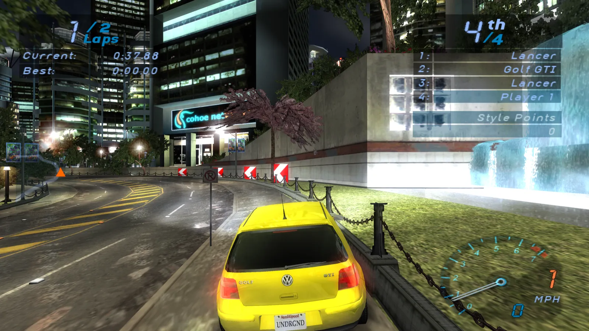
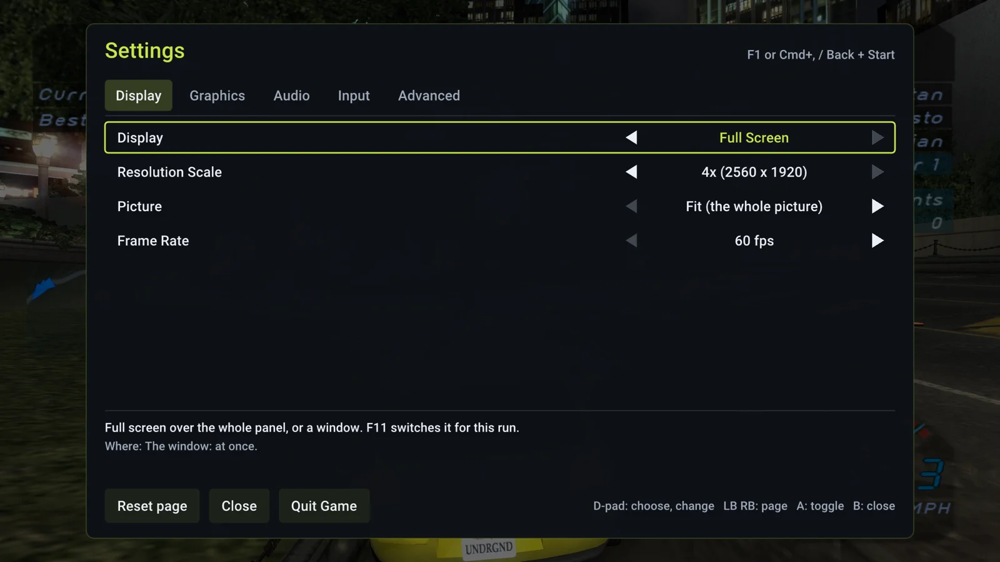
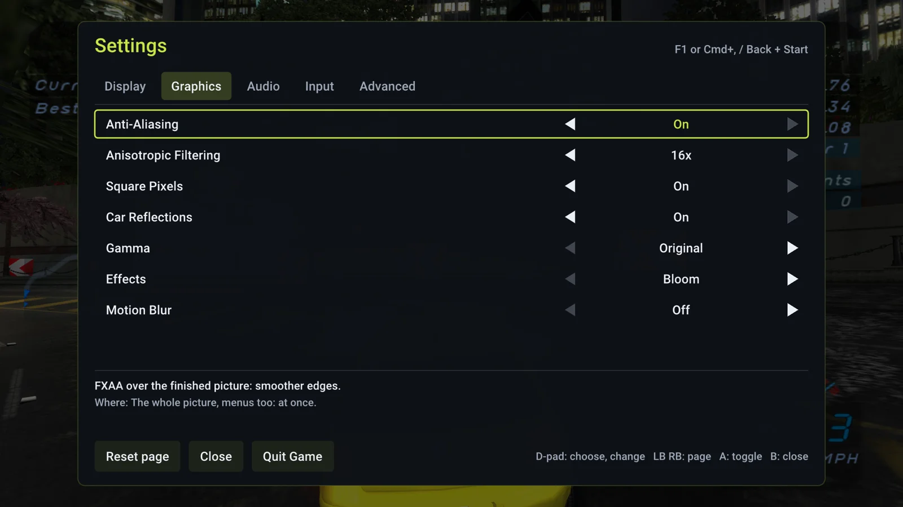
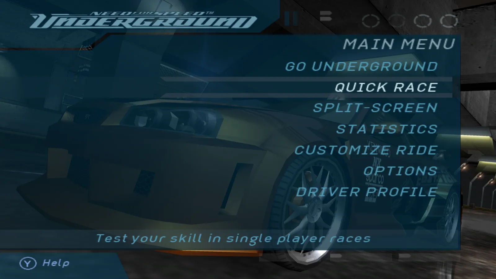
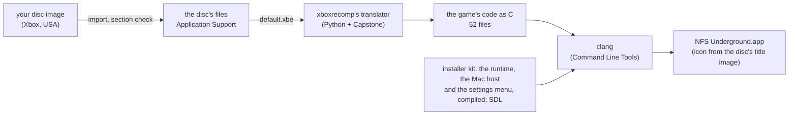
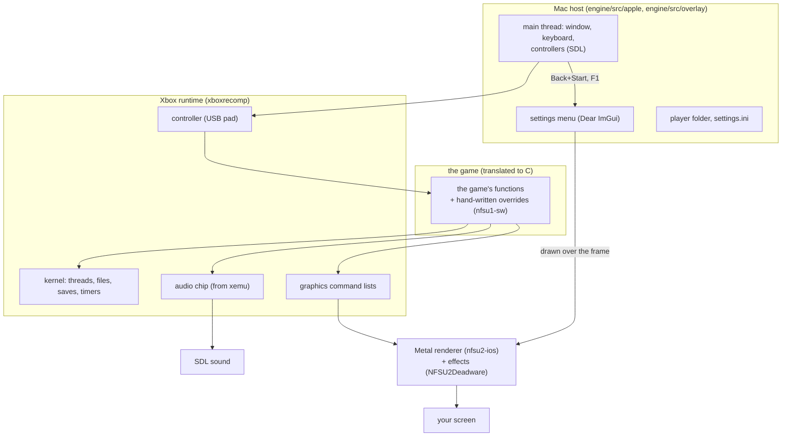

# NFS Underground for Mac

*Need for Speed: Underground* (EA Black Box, 2003), the original Xbox version, running natively on Apple Silicon Macs.

## What it is

The game's own program, translated from the Xbox's x86 code into C and compiled for your Mac. It is not an emulator: there is no
virtual Xbox, the game runs as a normal Mac app, with the disc's own cars, city, music, text and movies. On top of that it has the
things that make it play well on a Mac: 60 fps, a 16:9 picture, up to 4x the Xbox's resolution, bloom, ambient occlusion and a
settings menu over the game.

Almost everything here is other people's work, and this is their port as much as ours:

- [nfsu1-sw](https://github.com/antoxa2584x/nfsu1-sw) by **antoxa2584x** made the game run outside the Xbox, with
  [xboxrecomp](https://github.com/sp00nznet/xboxrecomp) by **sp00nz**, which translates Xbox games to C and stands in for the
  Xbox's hardware and system.
- [nfsu2-ios](https://github.com/myUdav4iik/nfsu2-ios) by **myUdav4iik** brought the same engine to Apple devices, with a Metal
  renderer; NFS Underground uses its Apple host and renderer.
- [NFSU2Deadware](https://github.com/LeoDeadware/NFSU2Deadware) by **LeoDeadware** made the engine a Mac game: the resolution,
  the effects, the pacing, and the idea of building the game on the player's own Mac.

This project puts them together without changing the game's look (no HD texture packs, no translation), and shares the settings
menu, the installer and the style with the other ports in this series
([NFS Underground 2](https://github.com/sanyokkua/nfsu2-xbox-port),
[NFS Hot Pursuit 2](https://github.com/sanyokkua/nfs-hp2-ps2-port),
[ProStreet](https://github.com/sanyokkua/speedbreaker-prostreet)).

**Status:** the menus and Quick Race work at 60 fps on an M1 Pro with a gamepad or the keyboard.

- It is an experiment, worked on when time allows; it is **not actively supported**.
- The game has **not been played from start to finish** on it; Career (Go Underground) and its saves are untested.
- Apple Silicon and **macOS 15 or newer** only, and only the **Xbox USA disc** (the European edition has another program and
  would need its own build).

How it was made, step by step: [docs/PORTING.md](docs/PORTING.md). Changes per version: [CHANGELOG.md](CHANGELOG.md).

## Install and play

You need an **Apple Silicon Mac with macOS 15 or newer** and your own disc image (ISO) of the **USA Xbox release** of
*Need for Speed: Underground*. Nothing of the game is included: the installer builds it on your Mac from your disc.

1. Download `NFS-Underground-<version>.dmg` from [Releases](https://github.com/sanyokkua/nfsu-xbox-port/releases/latest),
   open it and drag **NFS Underground Installer** to Applications.
2. **Open it.** The installer isn't notarized by Apple, so the first time macOS refuses. Close that message (don't move it to the
   Trash), go to **System Settings > Privacy & Security**, scroll to the message about it, click **Open Anyway** and confirm.
3. **Apple's Command Line Tools.** The game is compiled with them. If they aren't installed, macOS offers to install them: click
   Install, and the installer goes on by itself when they are there.
4. **Choose your disc image.** The installer copies the game's files (1.8 GB) into
   `~/Library/Application Support/NFS Underground`, checks that it is the USA disc, translates the game's program to C and
   compiles it. On an M1 Pro that takes about 2 minutes 20 seconds, once. A window shows how far it is.
5. **NFS Underground** is put in Applications (in `~/Applications` when Applications isn't writable) and opens. Play it from
   there. You can delete the disc image and the installer afterwards; opening the installer again offers Play or Rebuild.

### Controls

**A controller** works as on the Xbox: anything macOS knows (Xbox, PlayStation, MFi). Connect it before or while the game runs.

**The keyboard** drives the game when no controller is connected (Settings > Input can make it always or never):

| Key | Xbox controller | In the game |
|---|---|---|
| Arrows | D-pad and left stick | menus, steering |
| A / D | left stick left / right | steering |
| W / S | right / left trigger | gas / brake and reverse |
| Enter | A and Start | select, "press Start", pause |
| Esc, Backspace | B | back |
| Space / Left Shift | X / Y | |
| Q / E | White / Black | |
| Tab / P | Back / Start | |
| I J K L | right stick | |

The keys can't be changed yet. The controller's buttons are the game's own Xbox layout.

### The settings menu

| | Controller | Keyboard and mouse |
|---|---|---|
| Open and close | **Back + Start** together | **F1** (on a MacBook **fn+F1**, unless the F-keys are set as standard keys) or **Cmd+,** |
| Choose a setting | D-pad or left stick up/down | arrows up/down, or the mouse |
| Change it | D-pad or left stick left/right, **A** | arrows left/right, Enter, or click the arrows |
| Change page | **LB / RB** | Q / E, Tab |
| Close | **B** | Esc |

While the menu is open the game gets no input. Under the list, the chosen setting says what it does, **where** you will see it
and, after a change, whether it was applied at once or needs a restart. At the bottom: **Reset page**, **Close** and **Quit Game**.

| Page | Setting | Choices | Applies |
|---|---|---|---|
| Display | Display | Window, Full Screen | at once (F11 also switches it, for this run) |
| | Resolution Scale | 1x, 1.5x, 2x, 2.5x, 4x (default) | at once |
| | Picture | Fit (the whole 16:9 picture, default), Fill (a 16:10 screen filled, the sides cut) | after a restart |
| | Frame Rate | 60 fps (default), 30 fps (the Xbox's) | after a restart |
| Graphics | Anti-Aliasing, Anisotropic Filtering, Square Pixels, Car Reflections | On/Off, Off-16x | at once |
| | Gamma | Original, Modern (brighter), Warm | at once |
| | Effects | Bloom (default), Bloom + Ambient Occlusion, Off | at once |
| | Motion Blur | Off (default), On | at once |
| Audio | Master Volume | 0-100% (50% default) | at once |
| Input | Keyboard as Controller | Without a controller (default), Always, Off | after a restart |
| Advanced | Performance Overlay | frames per second and the slowest frame, top left | at once (also **Cmd+Option+F**) |
| | Logs | opens the logs folder in Finder | |

Resolution Scale and the Graphics on/off rows are the same settings as the game's own **Options > Camera** (nfsu1-sw put them
there: the game's Display page has no room); changing them in either place changes both. The game's own sliders for music and
effects are in its **Options > Audio**.

### Saving and quitting

The game saves the way it always did: in its menus (profiles, Career). To quit, use **Quit Game** in the settings menu (it asks
first), **Cmd+Q**, or close the window. Progress since your last save in the game is lost, as when an Xbox is switched off.

### Your files

Everything is in `~/Library/Application Support/NFS Underground/`:

| Folder | What |
|---|---|
| `game/` | the disc's files, and the game's saves (`UDATA/`) |
| `player/` | `settings.ini` (the settings menu), `nfsu1x_options.txt` (the game's Options > Camera rows) |
| `saves/`, `cache/` | the runtime's |
| `logs/` | `nfsu1.log` (the last five runs) and `install.log` |

To remove the game, delete **NFS Underground** from Applications and this folder.

## Screenshots

| | |
|---|---|
|  |  |
| A Quick Race at night, Resolution Scale 4x | The settings menu: Display |
|  |  |
| The settings menu: Graphics | The main menu |

Taken on an M1 Pro, in a window.

## How it works

The Xbox runs the game's program, an x86 file called `default.xbe`, on an Intel CPU with Microsoft's kernel and an NVIDIA
graphics chip. A Mac has none of these, so:

- **The program is translated once.** A translator written in Python (xboxrecomp's) reads `default.xbe`, finds its functions
  (about 12,900) and writes each as a C function. Apple's compiler turns that C into ARM code for your Mac. This happens on your
  Mac, from your disc, when you install: the download holds none of the game.
- **A runtime stands in for the Xbox.** What the game asked of the Xbox's kernel (threads, files, saves, timers) is done by
  xboxrecomp's runtime with macOS. The memory layout is the Xbox's own, so the game's pointers work unchanged.
- **Graphics:** the game still talks to the Xbox's graphics chip (it writes the chip's command lists). The runtime reads those
  commands and nfsu2-ios's Metal renderer draws them on your Mac's GPU, at a higher resolution. nfsu1-sw widens the 3D view to
  16:9 (Hor+); NFSU2Deadware's code adds bloom, ambient occlusion and the frame pacing.
- **Sound:** the Xbox's audio chip is emulated (code from the xemu emulator) and played through SDL.
- **Hand-written parts:** a few dozen functions are replaced by hand (nfsu1-sw): the frame-rate limit, the widescreen view, the
  extra rows in the game's Options, and the places where a straight translation of the Xbox code doesn't work.

## Architecture

### From your disc to the app (once, when you install)



### While you play



### The repository

| Folder | What |
|---|---|
| `engine/` | everything the game is built from: the runtime (`xboxrecomp/`), the game's overrides and the Mac host (`src/`), the settings menu (`src/overlay/`), Dear ImGui and the font (`third_party/`) |
| `installer/`, `mac/` | the installer app and the scripts it runs on the player's Mac (import and disc check, build, icon, app) |
| `tools/` | for developers: dependencies, release build, boot check, play, the installer kit and DMG, publish check |
| `tests/` | `dmg_no_game_code.sh`: the DMG holds no game code or data |
| `docs/` | how the port was made, how `engine/` was put together (`upstream-patches/`), screenshots |

Everything the port is built from is in this repository; nothing is downloaded at build time but SDL's pinned source and
Capstone (pip). The repository and the DMG hold no game files and no translated code.

### Build from source (macOS, Apple Silicon)

```sh
brew install cmake ninja
python3 -m venv .venv && .venv/bin/pip install 'capstone<6'
python3 mac/import_disc.py <your .iso> game/extracted   # your disc's files, checked
tools/build_deps.sh                   # SDL3 + sdl2-compat for macOS 15+ -> build/deps
tools/build_release.sh                # translate (engine/gen) + build -> build/release/nfsu2_recomp
tools/smoke.sh                        # boot check: 75 s, START presses, the settings menu, the last frame not black
tools/play.sh                         # play this build (its own player folder)
tools/make_dmg.sh                     # the installer DMG, checked by tests/dmg_no_game_code.sh
```

The binary keeps the name `nfsu2_recomp`, and the environment variables their `NFSU2_` names: nfsu1-sw is a fork of nfsu2-sw
and shares its glue.

**Diagnostics.** Environment variables: `NFSU2_GAME_DIR=<folder>` (the game's files; no player folder then),
`NFSU2_FPS_CAP=30|60` (wins over the menu for that run), `RECOMP_FPS_LOG=1`, `RECOMP_GL_DUMP=<prefix>,<frames>` (frame dumps),
`NFSU2_SMOKE_SECONDS=<n>`, `NFSU2_OVERLAY_SCRIPT="<s>:open,<s>:next,..."` with `NFSU2_OVERLAY_SHOT=<prefix>` (scripted menu steps
and screenshots). The installer: `NFSU1_IMPORT_ISO=<iso>`, `NFSU1_INSTALL_DIR=<folder>`, `NFSU1_NO_UI=1`. Disc check:
`python3 mac/xbe_check.py <default.xbe>`.

## Thanks

To everyone whose work this is built on:

| Project | Author | What it gives this port | License |
|---|---|---|---|
| [nfsu1-sw](https://github.com/antoxa2584x/nfsu1-sw) | antoxa2584x (Anton Artemov) | the game's translation and everything it needs to run: seeds, overrides, lifter fixes, Hor+ widescreen, the Options rows, 60 fps | no license file; used here with credit, under this project's GPL-3.0-or-later |
| [nfsu2-ios](https://github.com/myUdav4iik/nfsu2-ios) | myUdav4iik | the Apple host and the Metal renderer | no license file; as above |
| [xboxrecomp](https://github.com/sp00nznet/xboxrecomp) | sp00nz | the Xbox translator and runtime | MIT |
| [xemu](https://github.com/xemu-project/xemu) | xemu team | the audio chip and graphics parts in xboxrecomp | LGPL-2.1-or-later |
| [NFSU2Deadware](https://github.com/LeoDeadware/NFSU2Deadware) | LeoDeadware | the Mac engine patches (resolution, effects, pacing, mip chains), the installer's idea, kit, import and icon | MIT |
| [reUndr-ps5](https://github.com/bystritskiy/reUndr-ps5) | bystritskiy | the disc check by the executable's section digests | MIT |
| [SpeedBreaker](https://github.com/SpeedBreakerProject) | project(u) | the idea and the style of these Mac ports, the settings menu's design | GPL-3.0 |
| [Dear ImGui](https://github.com/ocornut/imgui) | Omar Cornut | draws the settings menu | MIT |
| [Roboto](https://fonts.google.com/specimen/Roboto) | Google | the settings menu's font | Apache-2.0 |
| [Capstone](https://github.com/capstone-engine/capstone) | Capstone team | reads the x86 code for the translator | BSD-3-Clause |
| [SDL](https://github.com/libsdl-org/SDL), [sdl2-compat](https://github.com/libsdl-org/sdl2-compat) | SDL team | window, input, controllers, sound | Zlib |

The license texts are in [LICENSES/](LICENSES/) and in the installer (`Contents/Resources/kit/licenses/`); details in
[THIRD_PARTY_NOTICES.md](THIRD_PARTY_NOTICES.md).

## License

GPL-3.0-or-later ([LICENSE](LICENSE), [NOTICE](NOTICE)). The files of nfsu1-sw and nfsu2-ios keep their authorship; how
`engine/` was made from them is in [docs/upstream-patches/](docs/upstream-patches/), and later changes are in this repository's
history. **If you reuse this code, keep the credit to those projects and their links**, as we do. NFSU2Deadware's code and
scripts stay under the MIT License, xboxrecomp's xemu parts under the LGPL-2.1 (the installer links them on your Mac, so they can
be relinked with your own versions).

## Legal notice

Unofficial fan project, not affiliated with or endorsed by Electronic Arts or Microsoft. *Need for Speed* and *Underground* are
trademarks of Electronic Arts Inc.; Xbox is a trademark of Microsoft. This repository and its releases contain no game code and no
game data: you need your own legally obtained copy of the game, and the game is built from it on your own Mac.
